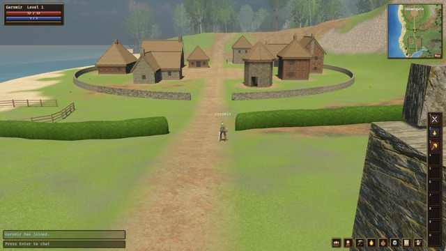
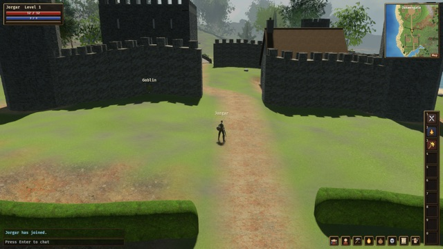
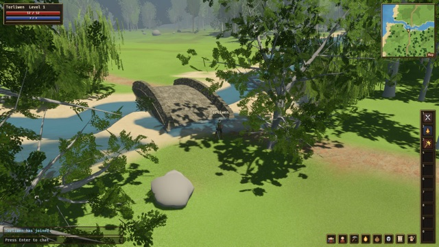
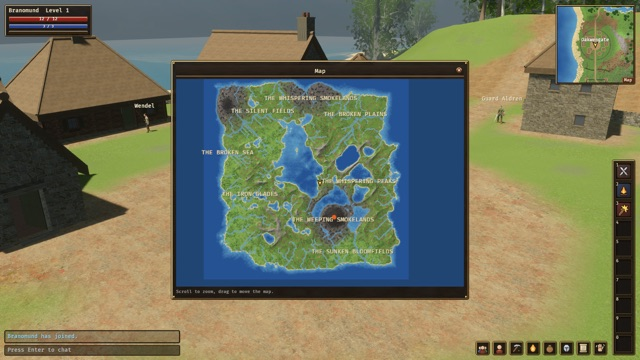
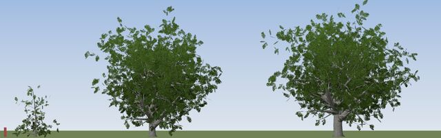
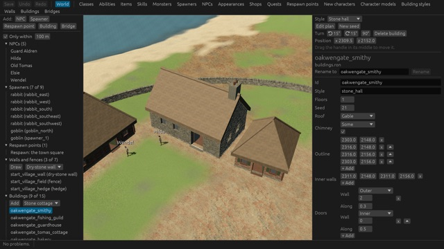
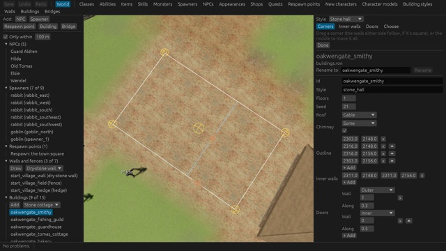

# Venture

<a href="screenshots/village.jpg"></a>
<a href="screenshots/castle.jpg"></a>
<a href="screenshots/bridge.jpg"></a>
<a href="screenshots/map.jpg"></a>

A medieval fantasy MMORPG I'm making in Rust. What I'm after is the big, lush, hazy world
of Lineage 2, where half the fun is just setting off on foot and seeing what's over the
next hill, with the depth of skills you get in Old School RuneScape.

It's still early, but it's playable. You can host a server, have your friends join from
their browsers, and run around the starting town together: talk to the NPCs and do their
quests, fight goblins, fish, and chop down trees.

## What's in it

**The game** runs in a web browser or as a desktop app on Mac and Windows. Click the
ground to run there (or use WASD), pick Fighter or Mage, level up, and put abilities and
food on your hotbar. There's chat with speech bubbles, parties, a minimap, and a big map
of the world.

**The server** hosts the web version too, so anyone on your network can join by opening
the address it prints. It's in charge of everything that matters, so nobody can just
give themselves a sword. If you don't want a separate server, the desktop game can run
one inside itself.

**The world** is generated from a seed: a whole continent of hills, lakes, rivers, roads
and coastline, split into named regions with their own towns. I then shape it and fill
it in by hand on top: towns, castles, walls, NPCs and monsters. Generating it again from
the same seed always gives exactly the same world, so the hand-made parts never drift
out of place.

**The editor** is where all of that hand-made stuff happens. It shows the world as it
looks in the game, and you can place NPCs and monster spawners, draw walls, hedges and
fences, put down buildings and bridges, and edit all the game's content (classes,
abilities, items, quests, shops, dialogue, character models). When you're done,
**Save and play here** drops you into the game right where the camera is.

## Trees and buildings

<a href="screenshots/trees.jpg"></a>

None of the trees are modelled by hand. They're grown by a generator from settings like
age, height, lean and how bushy they are, and there are ten common British species so far
(oak, ash, birch, willow, yew and so on). That's an oak at three ages above. The species
live in `content/trees/species.ron`. The editor shows the trees already, and tools for
drawing woods and placing trees in it are on the way.

<a href="screenshots/editor.jpg"></a>
<a href="screenshots/floor-plan.jpg"></a>

Buildings are generated too. You give one an outline, its inside walls and doors, how many
floors, a roof shape and a style (stone hall, wooden cottage, castle and so on), and the
generator builds the walls, windows, roof and chimney. In the editor you can drag buildings
about, turn them, roll a new seed, or hit **Edit plan** to look straight down and drag the
corners and walls of the floor plan around. Walls and bridges work the same way, and the
world gets bridges over its rivers on its own wherever a path needs to cross one.

## Getting it running

You'll need Rust. For the web version you'll also need trunk and the wasm target:

```sh
rustup target add wasm32-unknown-unknown
cargo install --locked trunk
```

Then:

```sh
# Bake the world (writes the world/ folder)
cargo run --release -p venture_worldgen --bin bake

# Build the web version
(cd crates/client && trunk build --release --cargo-profile wasm-release)

# Run the server, then open the address it prints
cargo run --release -p venture_server
```

Or skip the server and the browser altogether:

```sh
cargo run --release -p venture_client -- --local   # the game, with its own server inside
cargo run --release -p venture_editor              # the editor
```

Server settings and game rules (like who's an admin) are in `server.ron`, and everything
else (NPCs, items, quests, scripts) is in `content/`.

## Controls

Left click to run somewhere, or WASD. Right drag or the arrow keys turn the camera, the
mouse wheel zooms, and Space jumps. Click a character to select it, then click it again to
talk to it, attack it, or follow it. Enter to chat (try `/help`).

The hotbar takes keys 1 to 0. The character window has a key per tab: C stats, K skills,
L abilities, I inventory, G gear, J quests, O emotes.

## More

There's a lot more detail in [`docs/`](docs). [The vision](docs/vision.md) is where I've
written up what I'm aiming for, [the roadmap](docs/roadmap.md) has what's next, and
[building and running](docs/building-and-running.md) covers everything else, including
Docker and Windows builds.

## Credits

The core RPG rules (in `crates/rpg`) follow the System Reference Document 5.1,
adapted for a real-time game:

This work includes material taken from the System Reference Document 5.1
("SRD 5.1") by Wizards of the Coast LLC and available at
<https://dnd.wizards.com/resources/systems-reference-document>. The SRD 5.1 is
licensed under the Creative Commons Attribution 4.0 International License
available at <https://creativecommons.org/licenses/by/4.0/legalcode>.

The character models, outfits, animations, sword and shield are by
[Quaternius](https://quaternius.com) (CC0). Every outside asset and its
licence is listed in [licenses/README.md](licenses/README.md).
